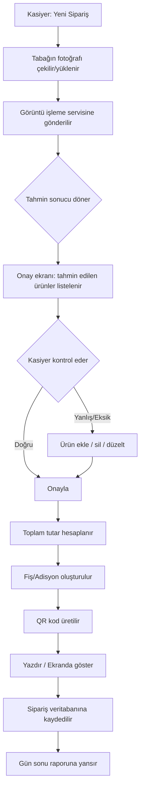
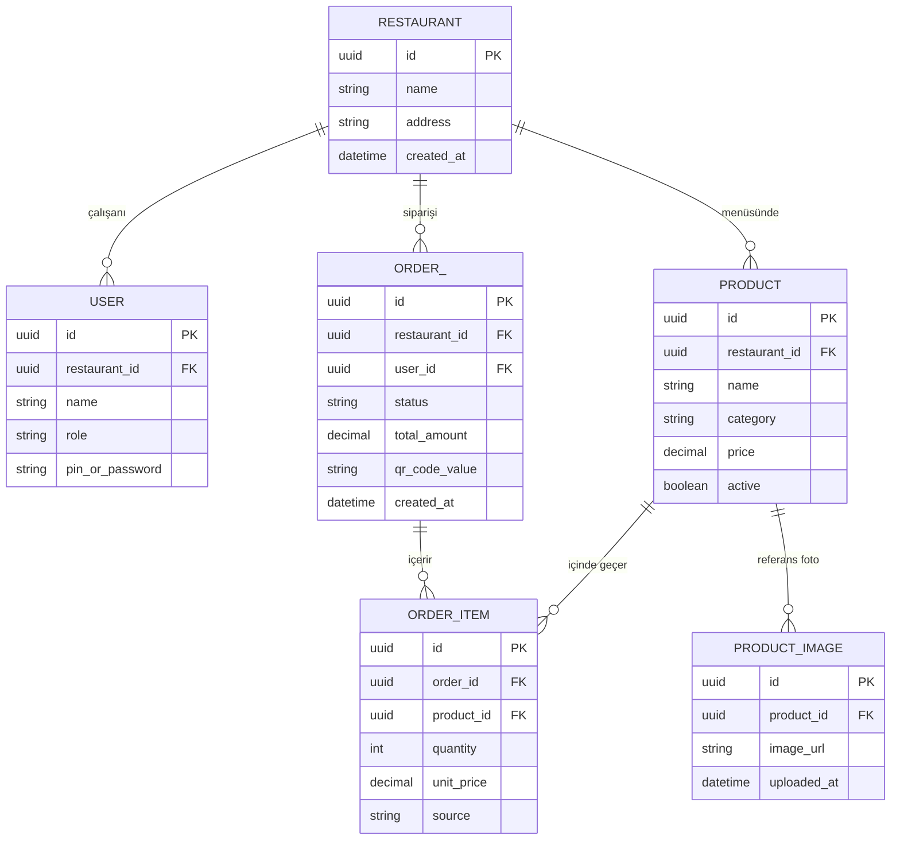
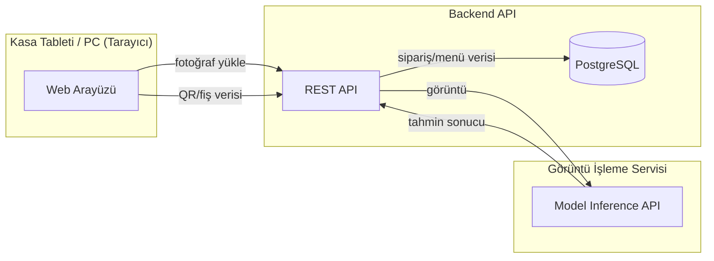

# Faz 1 — MVP Tasarımı (Detaylı Plan)

Bu doküman, ROADMAP.md içindeki Faz 1'in ("MVP Tasarımı") ayrıntılı çıktısıdır.
Faz 1'in amacı kod yazmak değil; **neyi, nasıl, hangi sınırlarla yapacağımızı netleştirmektir.**
Faz 2'de doğrudan bu dokümana bakarak geliştirmeye başlanabilmelidir.

---

## 1. Kapsam Sınırlaması (Scope)

MVP'nin başarısı, kapsamı ne kadar dar tuttuğumuza bağlı. Aşağıdaki tablo neyin
içeride neyin dışarıda olduğunu net çizer.

### Kapsam İçi (MVP'de VAR)
- Tek bir pilot restoran, tek şube
- Sabit/sınırlı menü: 10-15 ürün
- Tek kamera açısı (üstten, sabit ışık varsayımı)
- Ürün tespiti: "tabakta bu ürün var/yok" (adet MVP'de sabit 1 varsayılır)
- Kasiyer onay ekranı (ekle/sil/miktar değiştir)
- Fiyat hesaplama (KDV dahil basit toplam)
- Dijital fiş + QR kod üretimi
- Basit gün sonu raporu (toplam ciro, ürün bazlı adet)
- Tek kullanıcı rolü: Kasiyer (admin ayrımı minimal)

### Kapsam Dışı (MVP'de YOK — sonraki fazlarda)
- Porsiyon/gramaj tahmini (küçük/orta/büyük)
- Çoklu restoran / çoklu şube desteği
- Ödeme entegrasyonu (kart/online ödeme)
- E-fatura / e-arşiv entegrasyonu
- Stok/mutfak entegrasyonu
- Model sürekli öğrenme pipeline'ı (otomatik yeniden eğitim)
- Offline/edge çalışma modu
- Mobil native uygulama

> Not: Kapsam dışı maddeler unutulmuyor — bilinçli olarak sonraya erteleniyor.
> Bu liste "yapılmayacak" değil "şimdi yapılmayacak" anlamına gelir.

---

## 2. Örnek Pilot Menü (Tasarım için referans)

Gerçek pilot restoran belli olana kadar tasarımı somutlaştırmak için örnek bir
esnaf lokantası menüsü kullanıyoruz. Gerçek restoran seçildiğinde bu liste onunla
değiştirilecek.

| Kategori | Ürün | Fiyat (TL) |
|---|---|---:|
| Çorba | Mercimek Çorbası | 60 |
| Çorba | Ezogelin Çorbası | 60 |
| Ana Yemek | Tavuk Sote | 150 |
| Ana Yemek | Kuru Fasulye | 120 |
| Ana Yemek | Karnıyarık | 140 |
| Ana Yemek | Izgara Köfte | 160 |
| Yardımcı | Pilav | 50 |
| Yardımcı | Bulgur Pilavı | 45 |
| Salata | Çoban Salata | 55 |
| Salata | Mevsim Salata | 55 |
| İçecek | Ayran | 25 |
| İçecek | Kola | 40 |
| İçecek | Su | 15 |
| Tatlı | Sütlaç | 65 |
| Tatlı | Kazandibi | 70 |

15 ürün — MVP için görsel olarak makul derecede ayırt edilebilir bir set.

---

## 3. Kullanıcı Rolleri

| Rol | Yetkiler (MVP) |
|---|---|
| **Kasiyer** | Sipariş oluşturma, tahmin onaylama/düzeltme, fiş/QR üretme |
| **Yönetici (Admin)** | Menü yönetimi (ürün ekle/düzenle/sil, fiyat), gün sonu raporu görüntüleme |

MVP'de tek bir kişi her iki rolü de üstlenebilir (küçük restoranlarda kasiyer =
işletme sahibi olabilir), ama sistem tarafında ayrım yapılır ki ileride büyütülebilsin.

---

## 4. Kullanıcı Akışı (Uçtan Uca)



**Kritik tasarım kararı:** Adım E-F-G (onay adımı) asla atlanamaz. Sistem hiçbir
zaman kasiyer onayı olmadan fiş kesmez. Bu, MVP'nin güven inşa etmesi için şart.

---

## 5. Ekran Tasarımları (Wireframe — metinsel)

### Ekran 1: Ana Ekran / Sipariş Başlat

```
┌─────────────────────────────────────────┐
│  YemekQR – [Restoran Adı]                │
│                                           │
│         [  📷  Yeni Sipariş Al  ]        │
│                                           │
│  Bugünkü Ciro: 3.240 TL                  │
│  Bugünkü Sipariş Sayısı: 42              │
│                                           │
│  [Menü Yönetimi]     [Gün Sonu Raporu]   │
└─────────────────────────────────────────┘
```

### Ekran 2: Kamera / Fotoğraf Yakalama

```
┌─────────────────────────────────────────┐
│  ← Geri              Tabağı Fotoğrafla   │
│                                           │
│   ┌───────────────────────────────┐     │
│   │                                 │     │
│   │      [ Canlı Kamera Görüntüsü ] │     │
│   │                                 │     │
│   └───────────────────────────────┘     │
│                                           │
│           (   📸 Çek   )                 │
│                                           │
│  İpucu: Tabağı çerçeve içine ortalayın   │
└─────────────────────────────────────────┘
```

### Ekran 3: Tahmin Sonucu + Onay

```
┌─────────────────────────────────────────┐
│  ← Geri          Tespit Edilen Ürünler   │
│                                           │
│  ✅ Tavuk Sote            150 TL   [x]   │
│  ✅ Pilav                  50 TL   [x]   │
│  ✅ Çoban Salata           55 TL   [x]   │
│  ❓ Ayran (emin değilim)   25 TL   [x]   │
│                                           │
│  [ + Ürün Ekle ]                         │
│                                           │
│  ───────────────────────────────────     │
│  Toplam:                     280 TL      │
│                                           │
│         [   Onayla ve Fiş Kes   ]        │
└─────────────────────────────────────────┘
```

Not: "❓" işareti düşük güven skorlu tahminleri işaretler — kasiyerin dikkatini
oraya çeker. `[+ Ürün Ekle]` menüden manuel arama/seçim yapan basit bir liste açar.

### Ekran 4: Fiş / QR Özeti

```
┌─────────────────────────────────────────┐
│              Sipariş #1042               │
│                                           │
│  Tavuk Sote                    150 TL    │
│  Pilav                          50 TL    │
│  Çoban Salata                   55 TL    │
│  Ayran                          25 TL    │
│  ───────────────────────────             │
│  Toplam                        280 TL    │
│                                           │
│         [ QR KOD GÖRSELİ ]               │
│                                           │
│     [ Yazdır ]      [ Yeni Sipariş ]     │
└─────────────────────────────────────────┘
```

### Ekran 5: Menü Yönetimi (Admin)

```
┌─────────────────────────────────────────┐
│  ← Geri              Menü Yönetimi       │
│                                           │
│  [ + Yeni Ürün Ekle ]                    │
│                                           │
│  Tavuk Sote       150 TL   [Düzenle][Sil]│
│  Kuru Fasulye     120 TL   [Düzenle][Sil]│
│  Pilav             50 TL   [Düzenle][Sil]│
│  ...                                     │
└─────────────────────────────────────────┘
```

Ürün ekleme/düzenleme ekranında: ad, kategori, fiyat, referans fotoğraflar
(model eğitimi için — MVP'de bu fotoğraflar sadece saklanır, Faz 2'de eğitime
girer).

### Ekran 6: Gün Sonu Raporu

```
┌─────────────────────────────────────────┐
│  ← Geri            Gün Sonu Raporu       │
│                                           │
│  Tarih: 03.07.2026                       │
│  Toplam Sipariş: 42                      │
│  Toplam Ciro: 8.960 TL                   │
│                                           │
│  En Çok Satan Ürünler:                   │
│  1. Pilav           38 adet              │
│  2. Ayran           35 adet              │
│  3. Tavuk Sote      22 adet              │
│                                           │
│  [ Dışa Aktar (CSV) ]                    │
└─────────────────────────────────────────┘
```

---

## 6. Veri Modeli (MVP)



**Notlar:**
- `ORDER_ITEM.source`: `"ai_detected"` veya `"manual"` — hangi ürünün AI tarafından
  tespit edildiğini, hangisinin kasiyer tarafından elle eklendiğini ayırt etmek için.
  Bu alan, Faz 3'te "kasiyer düzeltme oranı" metriğini hesaplamak için kritik.
- `PRODUCT_IMAGE`: Faz 2'deki model eğitimi için referans veri kaynağı olacak.

---

## 7. API Taslağı (REST, MVP kapsamı)

| Method | Endpoint | Açıklama |
|---|---|---|
| `GET` | `/products` | Aktif menü ürünlerini listele |
| `POST` | `/products` | Yeni ürün ekle (admin) |
| `PUT` | `/products/{id}` | Ürün güncelle (admin) |
| `DELETE` | `/products/{id}` | Ürün pasifleştir (admin) |
| `POST` | `/products/{id}/images` | Referans fotoğraf yükle |
| `POST` | `/detect` | Tabak fotoğrafı gönder → tahmini ürün listesi + güven skorları döner |
| `POST` | `/orders` | Onaylanmış sipariş kaydet (ürün listesi + toplam) |
| `GET` | `/orders/{id}` | Sipariş detayını getir (fiş görüntüleme için) |
| `GET` | `/orders/{id}/qr` | QR kod görselini getir |
| `GET` | `/reports/daily?date=` | Gün sonu raporu verisi |

**`POST /detect` örnek yanıt:**
```json
{
  "detections": [
    { "product_id": "abc123", "name": "Tavuk Sote", "confidence": 0.91 },
    { "product_id": "def456", "name": "Pilav", "confidence": 0.88 },
    { "product_id": "ghi789", "name": "Ayran", "confidence": 0.62 }
  ]
}
```
`confidence < 0.7` olan sonuçlar arayüzde "❓ emin değilim" olarak işaretlenir
(eşik değeri Faz 2'de gerçek verilerle kalibre edilecek).

---

## 8. Teknik Mimari Kararı (Faz 1'de netleştirilecek)



**Kararlar:**
- Backend ve ML servisi **ayrı servisler** olarak tasarlanır (loose coupling).
  Böylece ML modeli değiştirilebilir/güncellenebilir, backend etkilenmez.
- Görsel dosyalar object storage'da (S3 uyumlu) tutulur, veritabanında sadece URL/referans saklanır.
- MVP'de senkron çağrı yeterli (fotoğraf → anında tahmin); yoğunluk artarsa
  asenkron kuyruk (queue) yapısına geçilebilir.

---

## 9. Faz 1 Kabul Kriterleri (Definition of Done)

Faz 1 şu çıktılar tamamlandığında biter:

- [x] Kapsam netleşti (bu doküman)
- [ ] Pilot restoran seçildi ve gerçek menüsü bu dokümana işlendi (örnek menü yerine)
- [ ] Tüm ekranların wireframe'leri onaylandı (kasiyer/işletme sahibiyle gözden geçirildi)
- [ ] Veri modeli ve API taslağı ekip içinde onaylandı
- [ ] Teknoloji yığını kesinleşti (ROADMAP.md §4'teki öneri teyit/revize edildi)
- [ ] Faz 2'nin ilk sprintinde ne yapılacağı net (bkz. §10)

---

## 10. Faz 2'ye Geçiş — İlk Sprint Önerisi

Faz 1 bittiğinde Faz 2'ye şu sırayla başlanması önerilir:

1. Proje iskeleti kurulumu (backend + frontend + DB migration)
2. Menü yönetimi ekranı (en basit CRUD, AI yok) — çalışan bir uçtan uca dilim
3. Sipariş oluşturma akışı (AI yok, tamamen manuel ürün seçimi) — fiş/QR üretimi çalışsın
4. Bu iki adım bittiğinde sistem zaten "manuel POS" olarak kullanılabilir hale gelir
5. Ardından `/detect` endpoint'i ve görüntü işleme entegrasyonu eklenir

Bu sıralamanın mantığı: **AI olmadan da çalışan bir iskelet önce kurulur.**
Böylece AI parçası gecikse veya ilk modelin doğruluğu düşük çıksa bile, restoran
sistemi manuel modda kullanmaya devam edebilir — risk azalır.

---

*Bu doküman, pilot restoran netleştikçe ve wireframe'ler üzerinde geri bildirim
alındıkça güncellenmelidir.*
