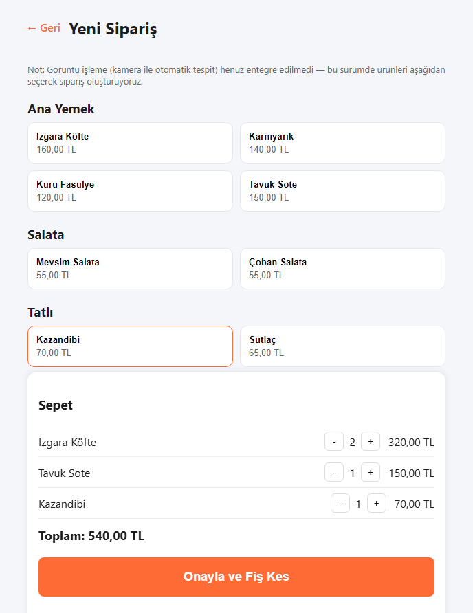
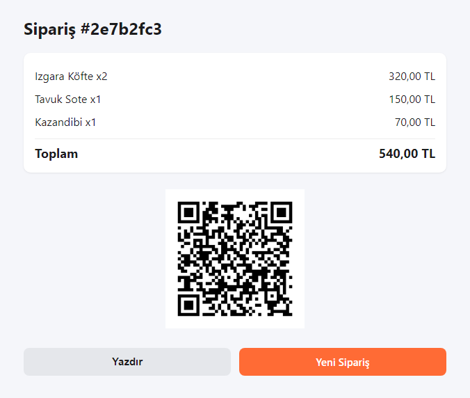
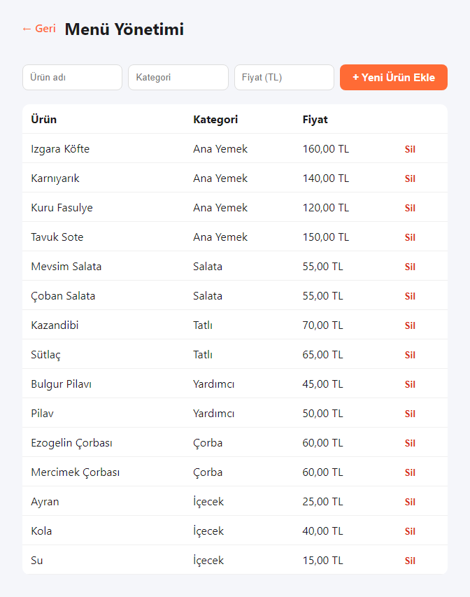
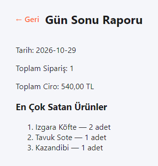
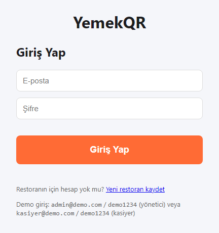
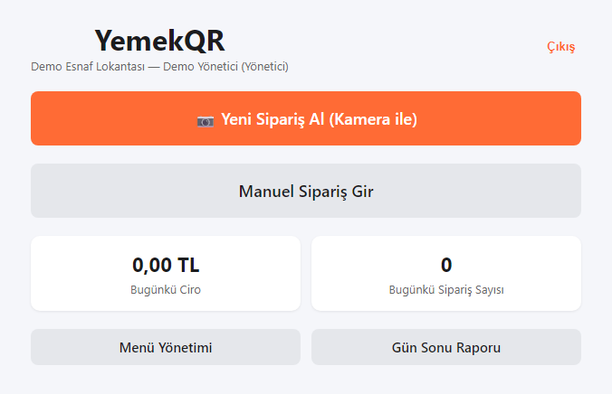
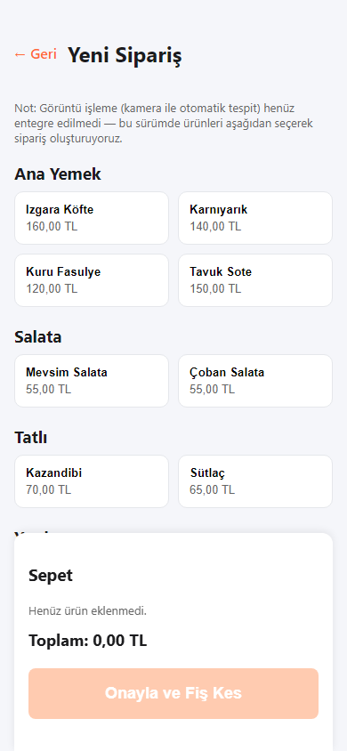

# YemekQR — Product & Architecture Showcase 🍽️📱

**English** | [Türkçe](README.tr.md)

**An AI-assisted point of sale (POS) and QR receipt platform for restaurants and cafeteria operations.**

Cashiers select dishes from categories or capture tray images via camera; the system generates an instant QR-coded digital receipt that customers can view on their phones without downloading an app or signing in.

> ℹ️ **About This Showcase:**  
> This repository is a **public product showcase and technical portfolio**. The full application source code (React frontend, Node.js/Express/Prisma backend, and Python/Gemini ML service) is kept in a private repository. This repository contains the system architecture, product roadmap, MVP design documents, and UI screenshots.

---

## 📸 Screenshots & UI Walkthrough

| New Order Screen (Dish & Category Selection) | QR Digital Receipt View |
|---|---|
|  |  |

| Menu Management Dashboard | Daily Summary & Sales Report |
|---|---|
|  |  |

| Cashier Login Screen | Home Dashboard | Mobile Responsive View |
|---|---|---|
|  |  |  |

---

## 🎯 Key Capabilities

- **Rapid Ordering & Till Management:** Category-based menu selection, instant quantity adjustments, and integer-based currency storage preventing floating-point rounding errors.
- **Zero-Friction QR Receipts:** Customers scan the QR code to access their itemized receipt and order status; no registration or login required.
- **Multi-Tenant Architecture:** Single centralized platform supporting multiple independent restaurants with scoped data isolation and JWT-based role separation (Admin vs. Cashier).
- **Vision-Assisted Ordering (ML Pipeline):** A dedicated Python microservice processes tray photos with Google Gemini Vision to propose order items for one-click cashier confirmation.
- **Auditable Daily Reporting:** Real-time revenue tracking, order volume metrics, and per-item sales distribution.

---

## 🏗️ System Architecture

```
 [Cashier Tablet / Web]     ────────► React 19 + TypeScript (Vite SPA)
                                              │ (REST API / JWT Auth)
                                              ▼
 [Backend Service]          ────────► Node.js + Express + Prisma ORM (SQLite / PostgreSQL)
                                              │ (Internal HTTP Requests)
                                              ▼
 [Computer Vision Service]  ────────► FastAPI Python Service ──► Google Gemini Vision API
```

---

## 💻 Tech Stack

| Layer | Technology |
|---|---|
| **Frontend** | React, TypeScript, Vite, Tailwind CSS, Modern Responsive Layout |
| **Backend & Persistence** | Node.js, Express, Prisma ORM, SQLite / PostgreSQL, JWT Authentication |
| **Machine Learning & AI** | Python, FastAPI, Google Gemini Vision API, Transfer Learning Pipeline |
| **Testing** | Vitest, API integration tests |
| **Planning & Specs** | [docs/ROADMAP.md](docs/ROADMAP.md) · [docs/FAZ1_MVP_TASARIM.md](docs/FAZ1_MVP_TASARIM.md) |

---

## 🔒 Source Code Notice

This repository does not contain application source code, database credentials, or secret keys. It is published purely as an architectural case study and product showcase.
