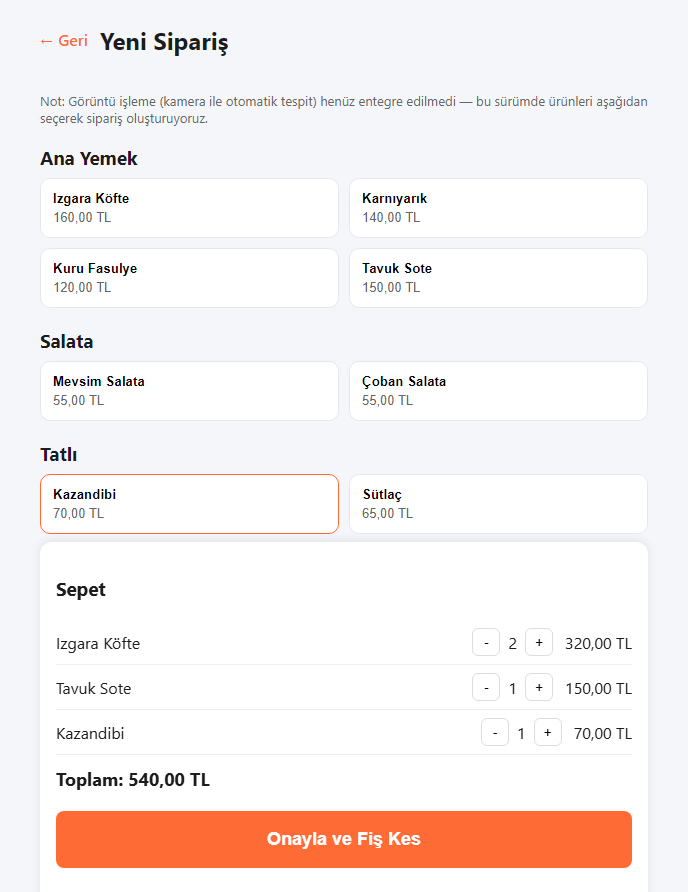
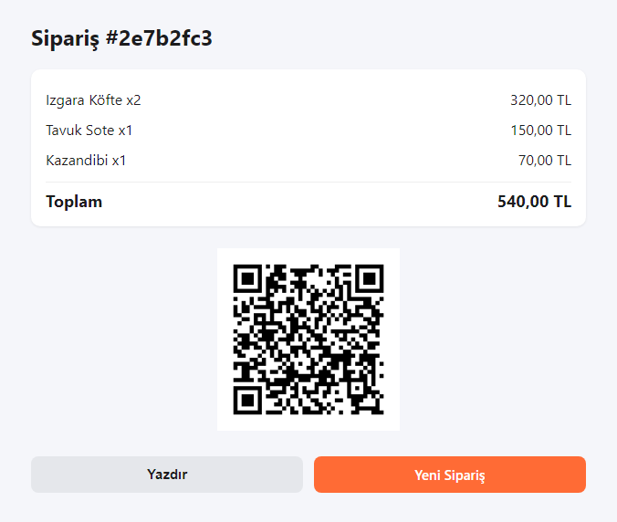
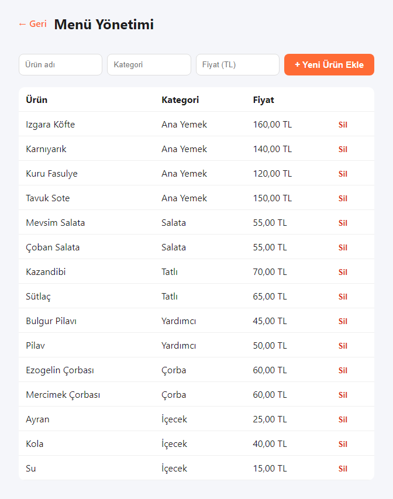
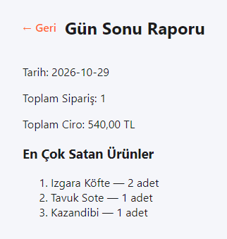
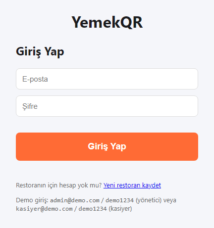
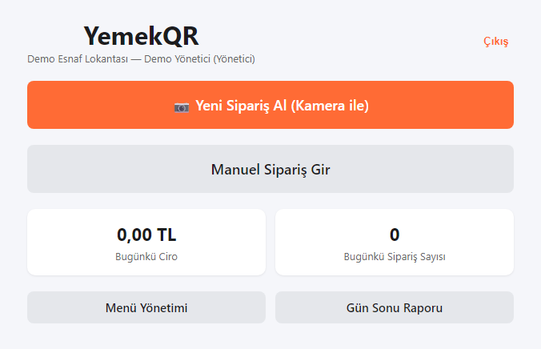
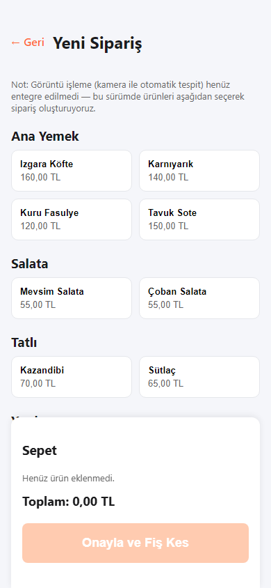

# YemekQR — Ürün ve Mimari Vitrini 🍽️📱

[English](README.md) | **Türkçe**

**Restoranlar ve self-servis işletmeler için yapay zekâ ve bilgisayarlı görü destekli satış noktası (POS) ve QR fiş sistemi.**

Kasiyer sipariş menüsünden yemekleri seçer (veya kamera ile tabak görselini taratır), sistem anında QR kodlu bir dijital fiş keser; müşteri masasında veya kasada QR kodu telefonuna okutarak fişine ve sipariş detaylarına giriş yapmadan ulaşır.

> ℹ️ **Bu Vitrin Hakkında:**  
> Bu depo **ürün tanıtımı ve teknik portföy** içindir. Uygulama kaynak kodları (React frontend, Node.js/Express/Prisma backend ve Python/Gemini ML servisi) ayrı bir **private** depoda tutulur. Bu depoda sistem mimarisi, yol haritası, MVP tasarım belgeleri ve arayüz ekran görüntüleri yayımlanmaktadır.

---

## 📸 Ekran Görüntüleri ve Arayüz Turu

| Yeni Sipariş Ekranı (Kategori & Yemek Seçimi) | QR Kodlu Dijital Fiş Ekranı |
|---|---|
|  |  |

| Menü Yönetimi Paneli | Gün Sonu Ciro ve Satış Raporu |
|---|---|
|  |  |

| Kasiyer Giriş Ekranı | Ana Sayfa Paneli | Mobil Görünüm |
|---|---|---|
|  |  |  |

---

## 🎯 Temel Özellikler

- **Hızlı Sipariş & Kasa Yönetimi:** Menüden kategoriye göre yemek seçimi, anlık miktar güncellemeleri, hızlı onay ve sıfır yuvarlama hatası için kuruş (tamsayı) bazlı tutulan hassas fiyatlandırma.
- **Kayıtsız QR Fiş:** Müşteri masasında veya kasada QR kodu kamerasıyla okutarak kendi sipariş fişine erişir; uygulama indirme veya üye girişi gerekmez.
- **Çoklu Restoran Desteği (Multi-Tenant):** Tek bir merkezi sistemde her restoran yalnızca kendi menüsünü, çalışanlarını ve raporlarını görür. Rol bazlı yetkilendirme (Yönetici vs. Kasiyer) JWT ile korunur.
- **Kamera ile Yemek Tanıma (ML Entegrasyonu):** Tabak/tepsi fotoğrafını işleyen Python servisi, Google Gemini Vision modeliyle yemekleri tespit edip kasiyere önerir; kasiyer tek tıkla onaylar.
- **Gün Sonu ve Finansal Raporlama:** Anlık ciro, sipariş hacmi ve yemek bazlı satış dağılım grafikleri.

---

## 🏗️ Sistem Mimarisi

```
 [Kasa Tableti / Tarayıcı]  ────────► React 19 + TypeScript (Vite SPA)
                                              │ (REST API / JWT)
                                              ▼
 [Backend Servisi]          ────────► Node.js + Express + Prisma ORM (SQLite / PostgreSQL)
                                              │ (HTTP İstekleri)
                                              ▼
 [Bilgisayarlı Görü Motoru] ────────► FastAPI Python Servisi ──► Google Gemini Vision API
```

---

## 💻 Kullanılan Teknolojiler

| Katman | Teknoloji |
|---|---|
| **Arayüz (Frontend)** | React, TypeScript, Vite, Tailwind CSS, Responsive Design |
| **Backend & Veritabanı** | Node.js, Express, Prisma ORM, SQLite / PostgreSQL, JWT Kimlik Doğrulama |
| **Görüntü İşleme & AI** | Python, FastAPI, Google Gemini Vision API, Transfer Learning Pipeline |
| **Test & Kalite** | Vitest, E2E akış testleri |
| **Planlama & Tasarım** | [docs/ROADMAP.md](docs/ROADMAP.md) · [docs/FAZ1_MVP_TASARIM.md](docs/FAZ1_MVP_TASARIM.md) |

---

## 🔒 Kaynak Kodu Bildirimi

Bu depoda uygulamanın kaynak kodları, veritabanı şemaları veya gizli anahtarlar **bulunmaz**. Depo yalnızca mimari inceleme ve teknik vitrin niteliğindedir.
