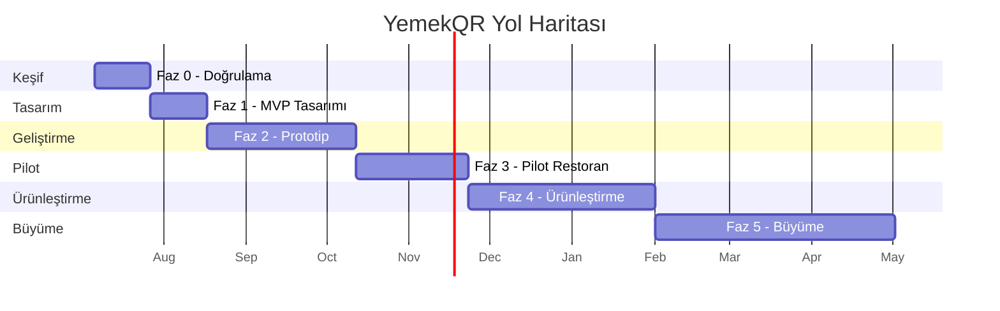

# YemekQR – Görüntü İşleme Destekli Otomatik Sipariş/Fiş Sistemi

## Yol Haritası ve Planlama

---

## 1. Vizyon

Restoranlarda (özellikle self servis, yemekhane, kafeterya tipi işletmelerde) kameradan
tabak görüntüsü alıp içindeki yemekleri tanıyan, fiyatlandıran ve kasiyer onayıyla
otomatik adisyon/fiş/QR sipariş kaydı oluşturan bir sistem.

**Konumlandırma:** "Tam otomatik" değil, "AI destekli, kasiyer onaylı" bir hızlandırma
aracı. Bu, hem teknik risk açısından hem de güven inşa etmek açısından en gerçekçi yol.

---

## 2. Hedef Kullanıcı ve İlk Pazar

- **Birincil hedef:** Self servis lokanta / esnaf lokantası / yemekhane / kafeterya
- **İkincil hedef:** Kurumsal yemekhaneler, oteller (açık büfe)
- **Üçüncül hedef:** Klasik masa servisi restoranlar (garson eliyle sipariş)

**Neden self servisle başlamalı:**
- Tabak zaten kasada, kamera açısı sabitlenebilir
- Menü sınırlı ve öngörülebilir
- Işık/ortam kontrol edilebilir
- Hata payı daha tolere edilebilir (kasiyer zaten oradadır, onay verir)

---

## 3. Faz Faz Yol Haritası

### Faz 0 — Keşif ve Doğrulama (2-3 hafta)

Amaç: Fikri kodlamadan önce gerçek dünyada doğrulamak.

- [ ] 3-5 gerçek restoran/lokanta ile görüşme (esnaf lokantası, yemekhane vb.)
- [ ] Mevcut kasa/adisyon süreçlerini gözlemleme (video/foto ile, izin alarak)
- [ ] Fiyat hassasiyeti ve ödeme isteği anketi ("aylık kaç TL öderdiniz?")
- [ ] Rakip analizi (Toast, Square, yerli POS sistemleri, varsa görüntü işleme tabanlı çözümler)
- [ ] Menü çeşitliliği analizi — kaç farklı ürün var, görsel olarak ne kadar ayırt edilebilirler
- [ ] Teknik fizibilite testi: telefon kamerasıyla 50-100 tabak fotoğrafı çekip elle
      incelemek — ürünler görsel olarak birbirinden ayrılabiliyor mu?

**Çıktı:** Gerçekten problem var mı, kaç kişi parayla çözüm ister, ilk pilot restoran adayı kim.

---

### Faz 1 — MVP Tasarımı (2-3 hafta)

Amaç: En dar kapsamda çalışan bir akış tasarlamak.

**Kapsam (bilinçli olarak dar tutulmalı):**
- Tek bir pilot restoranın menüsü (10-20 ürün) hedeflenir
- Sadece tabak/tepsi üstten fotoğraf → ürün tahmini → kasiyer onayı → fiş
- Porsiyon tahmini yok, sadece "ürün var / yok" tespiti (adet MVP'de sabit 1 kabul edilebilir)

**Ekranlar:**
1. Menü yönetimi (ürün adı, fiyat, kategori, referans fotoğraflar)
2. Kamera/fotoğraf yükleme ekranı
3. Tahmin sonucu + onay ekranı (ekle/sil/miktar değiştir)
4. Fiş/adisyon özeti + QR kod üretimi
5. Basit gün sonu raporu (toplam ciro, satılan ürün adetleri)

**Teknik mimari kararları:**
- Mobil mi web mi? → Öneri: **Web tabanlı (tablet/kasa PC'sinde tarayıcıda çalışan)**
  ilk sürüm, çünkü dağıtımı ve güncellemesi kolay, donanım bağımsız.
- Görüntü işleme: Kendi modelini sıfırdan eğitmek yerine transfer learning
  (ör. bir CNN backbone + restorana özel ince ayar) çok daha hızlı sonuç verir.
- Bulut mu cihaz üstü mü (edge)? → MVP'de bulut API (daha hızlı geliştirme),
  ileride internet kesintisi riskine karşı edge/offline mod düşünülebilir.

---

### Faz 2 — Prototip Geliştirme (4-8 hafta)

Amaç: Pilot restoranda gerçek veriyle test edilebilir bir prototip.

**2.1 Veri toplama**
- [ ] Pilot restorandan referans ürün fotoğrafları toplama (ürün başına 30-50 foto,
      farklı açı/ışık/porsiyon ile)
- [ ] Etiketleme (hangi foto hangi ürün)
- [ ] Veri artırma (data augmentation): döndürme, parlaklık, kırpma varyasyonları

**2.2 Model geliştirme**
- [ ] Görüntü sınıflandırma/nesne tespiti modeli seçimi
  (ör. YOLO tabanlı nesne tespiti — tabaktaki birden fazla ürünü aynı anda bulmak için,
  ya da her ürünü ayrı ayrı sınıflandırma)
- [ ] Transfer learning ile ilk model eğitimi
- [ ] Doğruluk ölçümü (confusion matrix, hangi ürünler karışıyor)
- [ ] Eşik değeri (confidence threshold) belirleme — düşük güvenli tahminlerde
      kasiyere "emin değilim" uyarısı

**2.3 Uygulama geliştirme**
- [ ] Backend API (menü, sipariş, fiş, kullanıcı/restoran yönetimi)
- [ ] Görüntü işleme servisiyle entegrasyon (senkron/asenkron istek)
- [ ] Frontend: kamera yakalama + onay ekranı
- [ ] Fiş/adisyon oluşturma mantığı (fiyat hesaplama, vergi/KDV, indirim)
- [ ] QR kod üretimi ve görüntüleme
- [ ] Basit yazıcı entegrasyonu (termal fiş yazıcı — ESC/POS protokolü)

**2.4 İç test**
- [ ] Kendi ekibinizle/simüle tabaklarla uçtan uca test
- [ ] Yanlış tanıma senaryolarını (karışık tabak, üst üste yemek, eksik ışık) test etme

---

### Faz 3 — Pilot Uygulama (4-6 hafta)

Amaç: Gerçek restoranda, gerçek müşterilerle canlı test.

- [ ] 1 pilot restoranda kurulum (kamera + tablet/PC + yazıcı)
- [ ] Personel eğitimi (kasiyer sistemi nasıl kullanacak, hata durumunda ne yapacak)
- [ ] Paralel çalışma: eski sistem + yeni sistem bir arada (güven oluşana kadar)
- [ ] Günlük hata takibi: yanlış tanınan ürünler, kasiyer düzeltmeleri kaydı
- [ ] Bu düzeltme verisiyle modeli yeniden eğitme (haftalık/iki haftalık döngü)
- [ ] Performans ölçümü:
  - Tanıma doğruluğu (%)
  - Ortalama sipariş alma süresi (öncesi/sonrası kıyas)
  - Kasiyer memnuniyeti
  - Müşteri deneyimi geri bildirimi

**Başarı kriteri örneği:** Doğruluk ≥ %85 ve sipariş alma süresi ≥ %30 azalma
gibi somut, önceden belirlenmiş hedefler koymak faz sonunda "devam/dur" kararını kolaylaştırır.

---

### Faz 4 — Ürünleştirme (6-10 hafta)

Amaç: Tek restorana özel prototipten, çoklu restorana satılabilir ürüne geçiş.

- [ ] **Restoran onboarding akışı:** Yeni restoran kendi menüsünü nasıl tanımlayacak,
      kendi ürün fotoğraflarını nasıl yükleyip modeli nasıl "öğretecek"
  (self-servis eğitim arayüzü — kritik özellik, ölçeklenebilirliğin anahtarı)
- [ ] Çoklu restoran / çoklu şube desteği (multi-tenant mimari)
- [ ] Rol yönetimi (kasiyer, mutfak, yönetici, admin)
- [ ] Ödeme entegrasyonu (kart/nakit/online ödeme sağlayıcıları)
- [ ] E-fatura/e-arşiv entegrasyonu (yasal gereklilik — Türkiye'de GİB entegrasyonu)
- [ ] Stok/mutfak entegrasyonu (satılan ürüne göre stok düşme)
- [ ] Raporlama paneli genişletme (haftalık/aylık trendler, en çok/az satan ürünler)
- [ ] Fiyatlandırma modeli belirleme (aylık abonelik, işlem başı komisyon, kurulum ücreti vb.)

---

### Faz 5 — Büyüme (sürekli)

- [ ] Yeni pilot restoranlarla genişleme (farklı mutfak türleri = modelin genelleme
      yeteneğini test etme fırsatı)
- [ ] Porsiyon/gramaj tahmini (gelişmiş özellik)
- [ ] Kalori/besin değeri analizi
- [ ] Müşteri tarafı QR ile self ödeme deneyimi
- [ ] Model sürekli öğrenme altyapısı (kasiyer düzeltmelerinden otomatik veri toplama pipeline'ı)
- [ ] Offline/edge çalışma modu (internet kesintisine dayanıklılık)
- [ ] Franchise/zincir restoranlara özel merkezi yönetim paneli

---

## 4. Önerilen Teknoloji Yığını (öneri, kesin değil)

| Katman | Öneri | Not |
|---|---|---|
| Frontend (kasa ekranı) | React / Next.js (web tabanlı) | Tablet tarayıcısında çalışır, dağıtımı kolay |
| Backend API | Node.js (NestJS/Express) veya Python (FastAPI) | Python, ML servisiyle entegrasyonu kolaylaştırır |
| Görüntü işleme | Python + PyTorch/TensorFlow, YOLOv8 veya benzeri nesne tespiti | Transfer learning ile hızlı başlangıç |
| Veritabanı | PostgreSQL | İlişkisel veri (menü, sipariş, restoran) için uygun |
| Dosya/görüntü depolama | S3 uyumlu object storage | Eğitim verisi ve referans fotoğraflar için |
| QR/Fiş | node-thermal-printer veya ESC/POS kütüphaneleri | Termal yazıcı entegrasyonu |
| Barındırma | Bulut (AWS/GCP/Azure) başlangıçta, ileride edge cihaz desteği | Model inference maliyetini izlemek önemli |

Not: Kesin teknoloji seçimi, ekibin mevcut deneyimine göre değişebilir — bu bir başlangıç önerisidir.

---

## 5. Riskler ve Azaltma Stratejileri

| Risk | Etki | Azaltma |
|---|---|---|
| Görsel olarak benzer yemekler karışabilir | Yüksek | Kasiyer onay adımı zorunlu, düşük güven eşiğinde manuel işaretleme |
| Işık/kamera açısı tutarsızlığı | Orta-Yüksek | Sabit kamera istasyonu, standart ışıklandırma kiti önerme |
| Restoranların yeni menü/sunum değişikliği | Orta | Kolay "yeniden öğretme" arayüzü, düzenli model güncelleme |
| Restoranların teknolojiye direnci | Orta | Paralel çalışma dönemi, basit ve hızlı eğitim, somut zaman tasarrufu gösterme |
| Model eğitimi için yetersiz veri | Yüksek (başlangıçta) | Data augmentation, sentetik veri, restoran bazlı az örnekle transfer learning |
| Yasal/mali entegrasyon (e-fatura vb.) | Orta | Faz 4'e kadar ertelenebilir, mevcut yerli POS sağlayıcılarla entegrasyon seçeneği |
| Donanım maliyeti (kamera, tablet, yazıcı) | Orta | Pilot için minimal donanım, restoranın mevcut donanımını kullanma seçeneği |

---

## 6. Yaklaşık Zaman Çizelgesi (özet)

Toplam MVP'den ilk satılabilir ürüne kadar yaklaşık **7-8 ay** öngörülür (tek/küçük ekiple).
Ekip büyüklüğüne ve haftalık çalışma yoğunluğuna göre bu süre kısalıp uzayabilir.

---

## 7. İlk 30 Günde Yapılacaklar (somut aksiyon listesi)

1. [ ] En az 3 restoran sahibiyle görüşme ayarla, problemi ve ödeme isteğini doğrula
2. [ ] 1 pilot aday restoran belirle (mümkünse tanıdık/erişimi kolay biri)
3. [ ] Pilot restoranın menüsünü çıkar, ürün sayısını netleştir (ilk MVP için 10-15 ürünle sınırla)
4. [ ] Pilot restoranda 100+ tabak fotoğrafı topla (farklı açı, ışık, porsiyon)
5. [ ] Basit bir görüntü sınıflandırma denemesi yap (ör. mevcut önceden eğitilmiş bir modelle
   transfer learning, küçük ölçekte) — teknik fizibiliteyi kendi gözlemle doğrula
6. [ ] Teknoloji yığınına karar ver, proje iskeletini oluştur (repo, backend, frontend, DB şeması)
7. [ ] Menü yönetimi ve kamera/onay ekranlarının wireframe'lerini çiz
8. [ ] Faz 1 kapsamını yazılı olarak netleştir ve pilot restoranla paylaş (beklenti yönetimi)

---

## 8. Başarı Metrikleri (KPI önerileri)

- **Tanıma doğruluğu:** Doğru tanınan ürün / toplam ürün
- **Kasiyer düzeltme oranı:** Kaç işlemde manuel müdahale gerekti
- **Ortalama sipariş süresi:** Eski yönteme göre kıyas
- **Restoran memnuniyeti / NPS**
- **Model iyileşme hızı:** Haftalık doğruluk artışı (yeniden eğitim döngüsüyle)
- **Pilot → ücretli müşteri dönüşüm oranı**

---

*Bu doküman canlı bir plandır — pilot geri bildirimlerine göre fazlar ve kapsam
güncellenmelidir. Katı bir sözleşme değil, yön gösteren bir pusula olarak kullanılmalıdır.*
